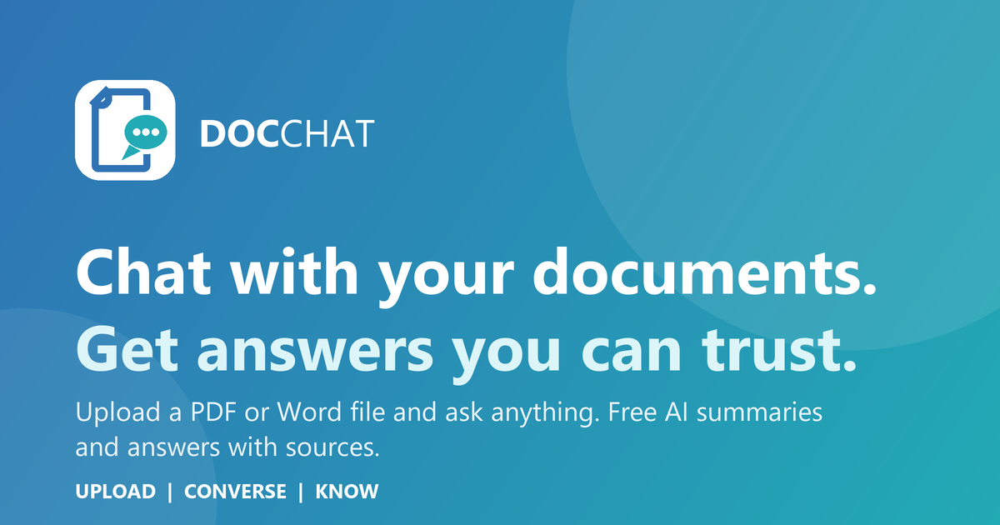

<p align="center">
  
</p>

<p align="center">
  <b>Upload a PDF, Word file or notes and ask anything.</b><br>
  DocChat reads your documents, summarizes them, and answers questions with sources.
</p>

<p align="center">
  <a href="https://docchat-006c.onrender.com"><b>Live demo</b></a> ·
  <a href="#features">Features</a> ·
  <a href="#how-it-works">How it works</a> ·
  <a href="#run-it-locally">Run it locally</a> ·
  <a href="#deploy-for-free">Deploy</a>
</p>

---

## Features

**Smart**
- **AI overview on upload:** document type, summary, key topics and four suggested questions
- **Answers with sources:** answers cite the document and page (exact citations with Claude)
- **"Ask next" suggestions:** three follow-up questions after every answer
- **Quick actions:** Summarize, Key facts, Action items, Explain simply, Quiz me, Find risks, Compare documents
- **Answer styles:** Concise, Balanced, Detailed, Simple

**App**
- **Sign in with Google** on a separate sign-up / log-in page; every account only sees its own chats
- **Saved chats** with search, rename, delete and Markdown export
- PDF, Word (.docx), text, Markdown, CSV and image uploads; drag and drop anywhere
- Streaming answers with stop, regenerate, copy and read-aloud
- Five color themes, light / dark / system mode, and a responsive layout (3 panels on desktop, drawers on mobile)
- Public landing page with SEO basics (meta tags, share image, sitemap, robots.txt)

**Under the hood**
- Pluggable AI providers: **Google Gemini** (free tier), **Ollama** (local and offline) or **Anthropic Claude**
- Per-visitor privacy, optional daily question limits, upload size caps and a privacy policy page

## Tech stack

| Layer | Tech |
|---|---|
| Backend | Python, Flask, Gunicorn, SQLite |
| AI | Google Gemini API (`google-genai`), Ollama, Anthropic Claude API |
| Documents | pypdf, python-docx |
| Auth | Google Identity Services, server-side ID token verification (`google-auth`), signed sessions |
| Frontend | Vanilla JavaScript, HTML, CSS (no framework), server-sent events for streaming |
| Hosting | Render (free web service via `render.yaml` Blueprint) |

## How it works

```
Browser ──upload──▶ Flask ──▶ extract text (pypdf / python-docx) ──▶ SQLite
   │                  │
   │ ask a question   ├─ rebuild the conversation from SQLite (documents attached to the turn they were added)
   │                  ├─ stream the answer from Gemini / Ollama / Claude
   ◀── server-sent ───┘   (the model ends with [[FOLLOWUPS]]; the server strips that part and sends
        events             the three follow-up questions separately)
```

- `app.py`: the Flask server (routes, auth, database, and one `*_stream` / `*_json` function pair per AI provider)
- `static/landing.html`, `login.html`, `index.html`, `privacy.html`: the public homepage, sign-in page, app and privacy policy
- `static/app.js`, `style.css`, `theme.js`: app logic, styles and the color-theme engine
- `mock_server.py`: runs the full UI with a fake AI, so you can work on the design without API calls

## Run it locally

```bash
git clone https://github.com/arronPhilip/docchat.git
cd docchat
python -m venv .venv
.venv\Scripts\pip install -r requirements.txt      # macOS/Linux: .venv/bin/pip
```

Create a `.env` file with a free Gemini key from https://aistudio.google.com/apikey:

```
GEMINI_API_KEY=your-key
# Optional: require Google sign-in (see below)
# GOOGLE_CLIENT_ID=xxxx.apps.googleusercontent.com
```

```bash
.venv\Scripts\python app.py
```

Open http://127.0.0.1:5000. Without `GOOGLE_CLIENT_ID` there are no accounts, which is handy for local use.

**Other providers:** `PROVIDER=ollama` (install [Ollama](https://ollama.com), then `ollama pull llama3.2:3b`)
or `PROVIDER=claude` with `ANTHROPIC_API_KEY`.

**No AI at all:** `python mock_server.py` runs the UI on http://127.0.0.1:5001 with a fake AI and its own `mock.db`.

## Deploy for free

1. Push this repository to GitHub (`.env` and the databases are git-ignored).
2. On [Render](https://render.com): **New > Blueprint** and pick the repository. `render.yaml` sets everything up;
   paste your `GEMINI_API_KEY` when asked.

| Setting | What it does |
|---|---|
| `DOCCHAT_PUBLIC=1` | Public mode: 10 MB uploads, demo notice, per-visitor privacy |
| `GOOGLE_CLIENT_ID` | Turns on Sign in with Google (create an OAuth Web client in Google Cloud and add your site as an authorized JavaScript origin) |
| `SECRET_KEY` | Signs the login cookie (Render generates it) |
| `DAILY_LIMIT` / `GLOBAL_DAILY_LIMIT` | Optional daily caps per visitor / for the whole site (0 = unlimited) |
| `GOOGLE_SITE_VERIFICATION` | Google Search Console ownership tag |

On Render's free plan the site sleeps after about 15 minutes idle and saved chats reset on restart.

## Privacy

Documents are processed by the configured AI provider. On Gemini's free tier, Google may use content to
improve its products, so the public demo asks users not to upload confidential files.
See the [privacy policy](https://docchat-006c.onrender.com/privacy).

## Author

**Arron Philip**, Computer Science student at Manchester Metropolitan University
[Portfolio](https://arronphilip.github.io/Portfolio/) · [GitHub](https://github.com/arronPhilip) · [LinkedIn](https://www.linkedin.com/in/arron-phlilp/)
